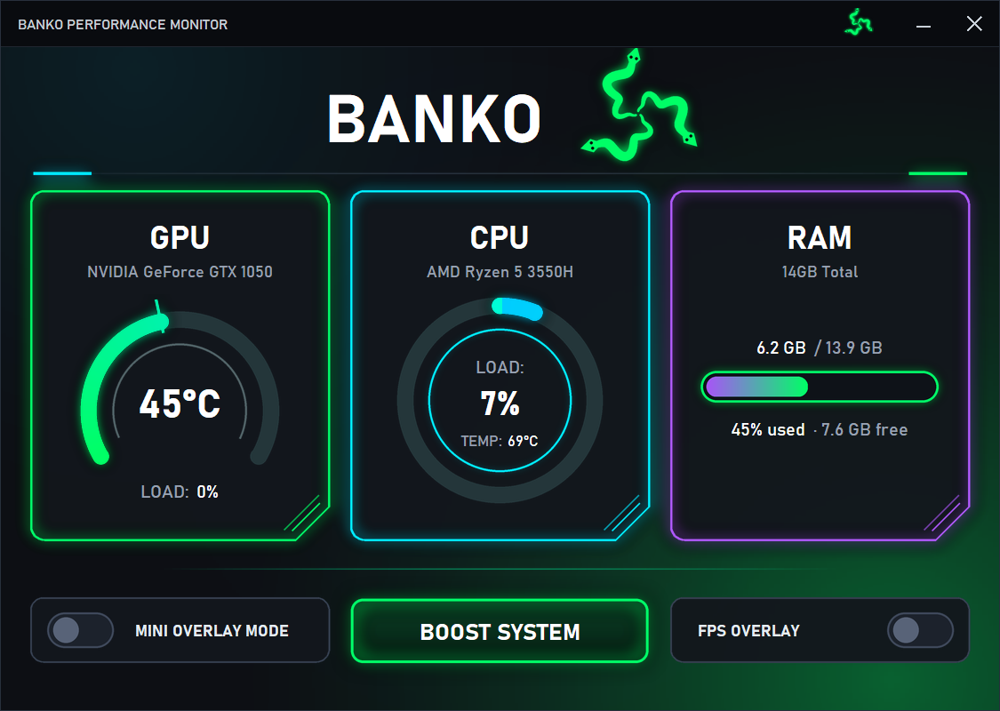

# BANKO Performance Monitor

Lightweight Windows desktop hardware monitor, gaming overlay, and one-click system optimizer built with Python, Pillow, `customtkinter`, and `psutil`.

- **Download Website**: https://hankobanko391.github.io/BANKO-Performance-Monitor/
- **Direct Windows Download (`v1.0.0`)**: https://github.com/hankobanko391/BANKO-Performance-Monitor/releases/download/v1.0.0/BANKO.exe



## Features

- **GPU Card (Neon Green/Cyan)**: Queries `nvidia-smi` silently in streaming mode (`CREATE_NO_WINDOW`) to show your NVIDIA GPU name, circular temperature (°C) arc gauge, and real-time GPU load.
- **CPU Card (Neon Cyan)**: Displays processor name, circular load ring (`psutil`), and background thermal sensor temperature (°C).
- **RAM Card (Neon Purple)**: Shows total memory, purple-to-green usage progress bar, and live used/free GB metrics.
- **Mini Overlay Mode**: Collapses into a compact, borderless, semi-transparent, draggable always-on-top bar for in-game monitoring.
- **Boost System**: Trims process working sets, cleans expired `%TEMP%` files, and switches Windows to the **High Performance** power plan (running as Administrator also flushes the Windows standby memory list).
- **FPS Overlay**: Toggles a click-through corner compositor FPS readout using Windows DWM timing (`DwmGetCompositionTimingInfo`).

## Run From Source

```powershell
pip install -r requirements.txt
python main.py
```

## Build Standalone Executable

```powershell
pyinstaller --onefile --noconsole --collect-all customtkinter --name BANKO main.py
```
